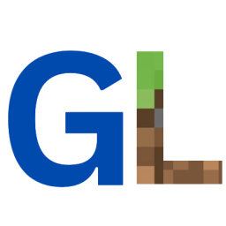

# Geffeniuse Launcher (Beta)

Small Minecraft launcher for modpacks. Rust core, Tauri window. No analytics, no trackers, no accounts of its own.

**NOT AN OFFICIAL MINECRAFT PRODUCT. NOT APPROVED BY OR ASSOCIATED WITH MOJANG OR MICROSOFT.** Minecraft is a trademark of Mojang AB / Microsoft.

Download: [geffeniuse.de](https://geffeniuse.de/launcher.html)

## Features

- Modrinth search and install, CurseForge install with your own API key (Settings)
- Import `.mrpack` and CurseForge `.zip` files
- Fabric, Quilt, Forge and NeoForge are set up automatically
- Java: uses an installed one, otherwise downloads Mojang's runtime (SHA-1 checked)
- Console (live game log), worlds overview, screenshots
- Microsoft login is required to play (no offline mode)
- Optional Discord Rich Presence (off by default; requires an Application ID)

Data lives in `~/.local/share/geffeniuse`.

## What the launcher connects to

Only what a feature needs, each time you use it: Microsoft/Xbox/Mojang (sign-in, skin, game files, version list), Modrinth, CurseForge (through `api-geffeniuse.deldown.de` unless you use your own key or switch it off), the loader servers of Fabric, Quilt, Forge and NeoForge, Mojang's launcher feed for version pictures (switchable), and the update server at OVH (Germany). Every one of them sees your IP address.

## Discord Rich Presence

In Options → Discord Rich Presence, enter the public Application ID of your Discord application and enable activity sharing. Create an application named Geffeniuse in the [Discord Developer Portal](https://discord.com/developers/applications) if needed. No bot token, client secret or Discord login inside the launcher is required. For packaged builds, `GEFFENIUSE_DISCORD_APPLICATION_ID` may supply the default ID at compile time; otherwise the field stays empty. Never use another application's ID.

The launcher connects only to the local Discord desktop client through IPC. It shares the generic status “Im Launcher” / “Spielt Minecraft”, its process ID and the Application ID. It sends no Minecraft account, modpack name, world, server address, playtime or join secrets. Discord can associate the status with the signed-in Discord account and display it according to Discord settings. Turning the option off clears the status; closing the launcher ends this integration even if the game keeps running. Reconnection is attempted after 15 seconds if Discord is unavailable. Linux/macOS use Unix sockets (including the common Linux Flatpak path); Windows uses named pipes. Sandboxed Discord installations may need their IPC socket exposed by the user.

Protocol reference: [Discord RPC](https://github.com/discord/discord-api-docs/blob/main/developers/topics/rpc.mdx). Live Discord verification remains pending until a real Application ID is configured.

## Status

Beta. Core features work and are tested, but expect rough edges. Please report bugs.

## Licence

MIT for the launcher's code (`LICENSE`). Pictures, logos and dependencies: `THIRD-PARTY-LICENSES.md`. Security reports: `SECURITY.md`.

## Build

```sh
cargo build --release -p geffeniuse
```

Needs `webkit2gtk-4.1` and `gtk3` on Linux. The binary is `target/release/geffeniuse`.

## Tests

```sh
cargo test --workspace
cargo test -p geffeniuse-core -- --ignored   # live tests: downloads Java, Forge, NeoForge, Minecraft
```

The live tests need a lot of memory and bandwidth.

## Layout

- `crates/core`: downloads, loaders, packs, launch, auth (no UI)
- `src-tauri`: window, protocol handlers; `src/commands/` holds the commands the UI calls
- `ui`: plain HTML, CSS and JS, no framework; `ui/js/` is one file per screen, loaded in order by `index.html`
- `installer`: the Windows setup program

The pictures for Minecraft 1.6 to 1.12 are not in the source tree (see `THIRD-PARTY-LICENSES.md`). Without them the version picker shows drawn pictures.
